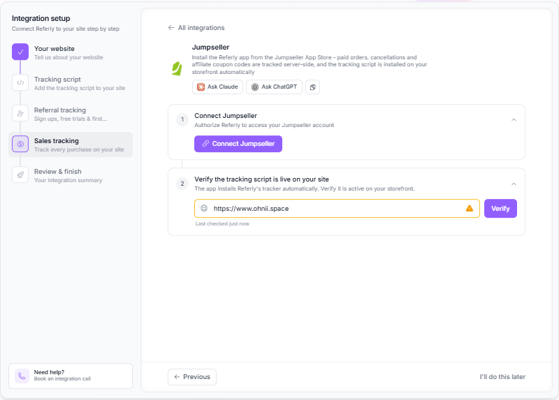
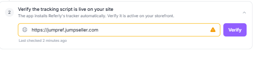

Referly connects to Jumpseller through an app you authorize for your store. Once connected, Referly installs a storefront tracking script and subscribes to order notifications. Manage your affiliate program, promotions, rewards and billing in Referly.

## What the Jumpseller integration can and can't do

| What you want to track | Does Jumpseller cover it? |
| --- | --- |
| **Clicks on affiliate links** | Yes. The app installs a storefront script automatically. Verify it on your published store. |
| **Paid orders** | Referly processes paid orders and can attribute them using a known affiliate code, a linked cart, or a supported referral value. |
| **Product-level commissions** | Order products can be used in [product-based commissions](/help-center/getting-started/commissions/product-based). |
| **Tax and shipping** | Order totals, tax and shipping are sent to Referly for commission calculation. |
| **Affiliate discount codes** | Yes. Create or sync supported Jumpseller promotions in Referly and assign their promo codes to affiliates. |
| **Returning customers** | Referly can match an existing referred customer by email or external customer ID when no new affiliate attribution is found. |
| **Cancellations** | A cancellation notification can reverse an eligible recorded sale. |
| **Refunds without cancellation** | Do not assume these reverse a reward automatically. Check the sale in Referly and adjust it if necessary. |
| **Custom scripts in checkout v2** | No. The app runs on the storefront, not inside checkout v2; test the full cart-to-order journey. |
| **Payment-method promotion targets** | Not supported by this integration. |
| **Standalone sign-ups** | Jumpseller order notifications don't report a sign-up without an order. See the [Universal integration](/help-center/integrations/universal). |

## Before you start

You'll need:

- **Access to your Jumpseller store** with permission to authorize apps.
- **A Referly account and affiliate program.** You can create a program during setup.
- **A test affiliate and a way to place a paid test order.**

## Step 1: Install and connect the app

<Steps>
  <Step title="Open the Jumpseller connection">
    In Referly, open your program's **Settings → Integrations**, choose **Jumpseller**, and select **Install the Referly app on Jumpseller**. You can also start from the Referly app in Jumpseller.
  </Step>
  <Step title="Authorize the app">
    Sign in to Jumpseller if asked, review the requested permissions and approve access to your store.
  </Step>
  <Step title="Choose your program">
    Sign in or create your Referly account. If you have one program, the store can connect automatically; if you have several, select the program that should receive its orders. If you have no program yet, follow the setup flow to create one.
  </Step>
  <Step title="Confirm the connection">
    Return to **Settings → Integrations** in Referly and open **Jumpseller**. Check the connected store name or store code.
  </Step>
</Steps>

### What the app sets up for you

- **Storefront tracking:** a JavaScript app loads Referly's tracker on the store layout; no theme snippet is required.
- **Order notifications:** Referly subscribes to paid, updated and canceled order events.
- **A store connection:** orders and promotion operations are associated with the selected Referly program.

<Tip>
  If you are reconnecting an existing store, check that it is still linked to the intended program before running a new test order.
</Tip>

## Step 2: Verify the tracking script

In Referly's integration setup, run the tracking-script verification against your **published storefront URL**, not your Jumpseller admin address. Open an affiliate link in a private window and confirm the click is recorded.

The script links a shopper's cart to a Referly click on the storefront. Checkout v2 does not run this script, so a successful click is only the first part of the test: complete an order and confirm attribution in Referly as well.

{/* TODO screenshot: Jumpseller connection and tracking verification */}

## Step 3: Decide how affiliates will promote you

### Referral links

Enable link tracking under [Tracking methods](/help-center/settings/program/tracking-methods) and share each affiliate's Referly link. Jumpseller-connected programs use **`ref`** or **`aff`** as their URL tracking parameter. Use the link Referly generates rather than changing the parameter yourself. Make sure your store URL is included in the **Landing Page URL** section

### Promotion codes

In Referly's **Coupons** page, create a coupon with **Jumpseller** as the source and assign promo codes to affiliates. You can also sync supported existing Jumpseller promotions and link their codes to affiliates. See [Create coupons](/help-center/engage/coupons/create).

Jumpseller calls the discount a *promotion* and its individual codes *coupons*. In Referly, the promotion appears as a coupon with promo codes. Redemption limits apply to individual codes, not a shared coupon-wide total.

Promotion targets include subtotal, shipping, selected products and buy-X-get-Y. Available conditions depend on the target. For selected products, Referly supports no minimum condition or a combined quantity of selected products; other minimum-condition modes cannot be reliably configured through the integration. Payment-method targeting is not supported.

## How Referly decides who gets credit

When a paid order is processed, Referly checks:

1. **An assigned affiliate promo code**, when coupon tracking is enabled.
2. **The cart-linked referral click**, when link tracking is enabled. If no cart link is available, Referly can use Jumpseller's order referral value.
3. **An existing referred customer**, matched by email or Jumpseller customer ID when no new affiliate was found.

The cart-linked click respects the program's cookie window. Jumpseller's native referral value is a fallback and is not the same as a cart-linked click. Attribution may be missed when the cart or referral information doesn't reach the order, so test the full journey on your store.

## Step 4: Place a test order

<Steps>
  <Step title="Open an affiliate link">
    Copy a test affiliate's link from Referly and open it in a private window. Confirm the click appears on the affiliate's record.
  </Step>
  <Step title="Complete a paid order">
    Add a product to the cart and check out using your normal store flow. Make sure the order is marked paid in Jumpseller.
  </Step>
  <Step title="Check the result">
    In Referly, check **Customers**, **Sales** and **Rewards** for the buyer, order and commission. If you use a product rule, check the commission amount too.
  </Step>
  <Step title="Test an affiliate code">
    Start a separate private session, place an order with an assigned affiliate promo code and confirm the correct affiliate is credited.
  </Step>
  <Step title="Check cancellation handling">
    Cancel a test order in Jumpseller and review the corresponding sale and reward in Referly. Automatic reversal is subject to the reward's eligibility and holding rules.
  </Step>
</Steps>

{/* TODO screenshot: Jumpseller test order and reward in Referly */}

## Cancellations and refunds

Referly handles Jumpseller cancellation notifications by attempting to mark the matching sale refunded. Automatic reversal can be refused for a reward that has already been paid or is beyond the applicable holding window.

The current integration does **not** separately process a refund-only order status as a reversal. If you refund without canceling, review the sale and adjust it in Referly where needed. Verify the result for partial refunds too; don't assume a proportional adjustment. See [Refunds](/help-center/manage/rewards/refunds) and [Reward holds](/help-center/manage/rewards/holds).

## Disconnecting your store

In Referly, open **Settings → Integrations**, select **Jumpseller**, and choose **Disconnect**. Remove the app in Jumpseller too if you no longer want it installed. Uninstalling the app also disconnects it from Referly.

Your previously recorded affiliates, customers, sales and rewards remain in Referly. Don't rely on orders placed while disconnected being automatically recovered when you reconnect.

## Troubleshooting

<AccordionGroup>
  <Accordion title="The storefront tracker isn't detected">
    Check that the correct store is connected, wait briefly for setup, and verify the published storefront address. If it still fails, reconnect the app and contact support.
  </Accordion>
  <Accordion title="A click was recorded but the order wasn't credited">
    Confirm link tracking is enabled and the order is paid. Retry with a fresh private window and the normal add-to-cart and checkout flow. Checkout v2 cannot run the tracking script, so attribution has to reach the order from the storefront or another supported source.
  </Accordion>
  <Accordion title="A promotion code didn't credit the affiliate">
    Confirm coupon tracking is enabled, the promotion is connected or synced in Referly, and its code is assigned to that affiliate. Test the code in a separate session without another affiliate link.
  </Accordion>
  <Accordion title="A promotion condition isn't available">
    The available conditions depend on the target. Selected Products supports no minimum or a combined selected-product quantity; payment-method promotions aren't supported.
  </Accordion>
  <Accordion title="The app asks me to reconnect">
    Restart the connection from Jumpseller or Referly, approve the requested permissions, and select the correct program. If an installation has expired, begin a fresh installation.
  </Accordion>
  <Accordion title="A refund or cancellation didn't reverse the reward">
    Refunds without cancellation are not automatically handled as reversals by the current integration. For cancellations, check whether the reward is still eligible for reversal; paid or past-hold rewards may require a manual adjustment.
  </Accordion>
</AccordionGroup>

## Related

<Columns cols={2}>
  <Card title="Create coupons" icon="ticket" href="/help-center/engage/coupons/create" arrow>
    Create and assign affiliate promotion codes.
  </Card>
  <Card title="Product-based commissions" icon="box" href="/help-center/getting-started/commissions/product-based" arrow>
    Set commission rules for products.
  </Card>
  <Card title="Reward holds" icon="clock" href="/help-center/manage/rewards/holds" arrow>
    Understand when rewards can be reversed.
  </Card>
  <Card title="Integrations overview" icon="grid-2" href="/help-center/integrations/overview" arrow>
    Explore other ways to connect Referly.
  </Card>
</Columns>
