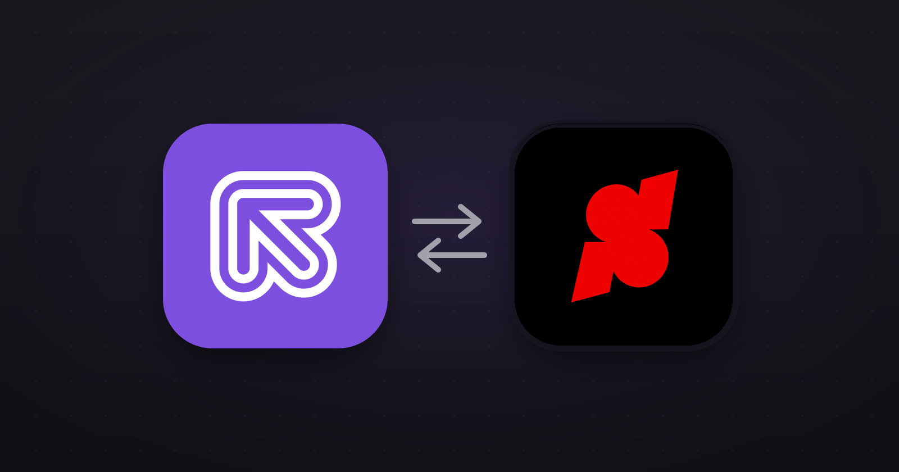
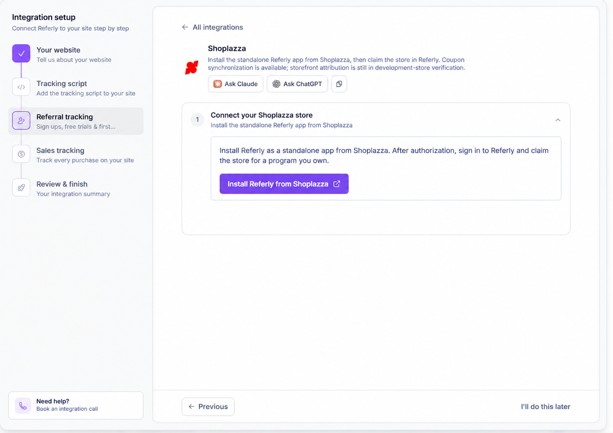

Referly connects to Shoplazza through an app you install from Shoplazza. After you connect your store to a Referly program, the app installs the storefront tracking script and registers order notifications for you. You manage your affiliates, rewards and discounts in Referly.

## What the Shoplazza integration can and can't do

| What you want to track | Does Shoplazza cover it? |
| --- | --- |
| **Clicks on affiliate links** | The app installs a storefront tracker automatically. Verify it and test your published storefront. |
| **Paid orders** | Referly processes paid orders associated with an affiliate through a supported link or coupon. |
| **Discount-code attribution** | Yes. Create or sync a Shoplazza discounts in Referly and assign its promo code to an affiliate. |
| **Products and collections** | Product data supports [product-based commissions](/help-center/getting-started/commissions/product-based); coupon settings also support product and collection targeting. |
| **Tax and shipping** | Order amounts include tax and shipping data, which can be excluded from commissions in your program settings. |
| **Refunds and cancellations** | Refund notifications and certain order-status updates can reverse an eligible recorded sale. Cancellation and deletion notifications alone do not reverse a sale. See [Refunds and cancellations](#refunds-and-cancellations). |
| **Partial refunds pro-rata** | No. A partial refund can reverse the full commission rather than a proportion. |
| **Sign-ups without an order** | Shoplazza's order integration does not report standalone sign-ups. See the [Universal integration](/help-center/integrations/universal). |
| **Every checkout or cart variation** | Not guaranteed. Test your actual storefront, cart and checkout flow before launch. |

## Before you start

You'll need:

- **Access to the Shoplazza admin** with permission to install and approve apps.
- **A Referly account and affiliate program.** You can create a program during the connection if you don't already have one.
- **A test affiliate and a way to place a test order**, so you can verify attribution end to end.

## Step 1: Install the Referly app

<Steps>
  <Step title="Open the app in Shoplazza">
    Find Referly in the Shoplazza App Store and start the installation from your store's admin.
  </Step>
  <Step title="Approve the permissions">
    Review the access Shoplazza requests and approve the installation. Referly uses the connection to install tracking and work with orders, products and discounts.
  </Step>
  <Step title="Connect a Referly program">
    Sign in to Referly, or create an account if needed. Choose the affiliate program that should receive this store's orders. If you need a program, follow the setup flow to create one.
  </Step>
  <Step title="Check the connection">
    In your program's **Settings → Integrations**, open **Shoplazza** and check that the store is connected. If setup reports a tracking or connection problem, resolve it before sending affiliates to your store.
  </Step>
</Steps>

### What the app sets up for you

- **Storefront tracking:** the app registers a script tag on the online store; you don't need to paste a theme snippet for the connected store.
- **Order notifications:** Referly registers notifications for orders, refunds, cancellations and app removal.
- **Product notifications:** Referly receives product updates for the connected store.

<Note>
  The Shoplazza integration view in Referly shows connection status and lets you disconnect. Start a new installation from Shoplazza rather than expecting an install button in that view.
</Note>

## Step 2: Verify tracking

Open the integration setup in Referly and verify your **published storefront URL**, not your Shoplazza admin address. Then open an affiliate link in a private window and check that the click appears in Referly.

The script records the visit and attempts to carry attribution through the cart. Different themes, cart operations and checkout paths may behave differently, so continue with the paid-order test below.

{/* TODO screenshot: Shoplazza connection and storefront verification */}

## Step 3: Choose how affiliates will promote you

### Referral links

Give affiliates their Referly links and enable link tracking in [Tracking methods](/help-center/settings/program/tracking-methods). Test the same shopping journey your customers use, including adding products to the cart and completing checkout. Make sure your store URL is included in the **Landing Page URL** section

### Discount codes

In **Coupons** in Referly, choose **Shoplazza** as the source, create a coupon and assign promo codes to affiliates. You can also sync supported existing Shoplazza discounts into Referly; make sure the code is assigned to the right affiliate before testing. See [Create coupons](/help-center/engage/coupons/create).

Shoplazza discounts can target orders, products or shipping, subject to the options shown in Referly. A redemption limit applies to each promo code, rather than one shared limit across all codes. For a minimum condition, Shoplazza permits either an order amount or an item quantity, not both.

## How Referly attributes an order

For a paid order, Referly looks for the referral carried with the cart and can also match an affiliate's known Shoplazza discount code. When both are available, the valid cart referral is used first; a matched coupon is used when there is no valid cart affiliate.

Cart attribution can be unavailable or conflicting if the required information does not reach the order. In that case, don't assume a click means the sale was credited. Check the order and reward in Referly and contact support if a test order is missing.

## Step 4: Place a test order

<Steps>
  <Step title="Copy an affiliate link">
    In Referly, copy a real link from a test affiliate and open it in a private window.
  </Step>
  <Step title="Check the click">
    Confirm the visit appears on the affiliate's record in Referly.
  </Step>
  <Step title="Buy through your usual checkout">
    Add a product to the cart and complete a test order. Make sure the order is marked paid in Shoplazza.
  </Step>
  <Step title="Check Referly">
    Find the sale and its affiliate in **Sales**, then check the corresponding reward. If you use product rules, confirm the expected commission was applied.
  </Step>
  <Step title="Test a coupon separately">
    In a fresh private window, place a paid order using an affiliate's assigned promo code. Confirm the correct affiliate receives credit.
  </Step>
</Steps>

{/* TODO screenshot: Shoplazza test order and reward in Referly */}

## Refunds and cancellations

When Referly receives a full or partial refund notification, or an order update with a refunded, partially refunded or voided financial status, it attempts to reverse the matching recorded sale. A partial refund can reverse the **whole** commission.

Cancellation and deletion notifications alone clear pending attribution; they do not reverse an existing sale. A separate qualifying refund notification or order update is needed for an automatic reversal.

An automatic reversal may be refused if the reward has been included in a payout batch, already paid, or is beyond the applicable holding window. A refund cannot be applied automatically if the matching sale is not found. Review the sale and make any necessary adjustment in Referly. See [Reward holds](/help-center/manage/rewards/holds) and [Refunds](/help-center/manage/rewards/refunds).

## Disconnecting your store

In Referly, open **Settings → Integrations**, select **Shoplazza**, and choose **Disconnect**. To remove the app from Shoplazza entirely, uninstall it in your Shoplazza admin.

Previously recorded affiliates, customers, sales and rewards remain in Referly. Don't rely on orders placed while disconnected being automatically recovered after reconnecting.

## Troubleshooting

<AccordionGroup>
  <Accordion title="The tracking script isn't detected">
    Confirm the store is connected, allow setup a little time, and verify the published storefront URL. If the connection reports a tracking issue, reconnect from Shoplazza or contact support.
  </Accordion>
  <Accordion title="A click was recorded but the paid order wasn't credited">
    Verify the order is paid and test the complete storefront-to-cart-to-checkout journey again. Use an assigned affiliate code as a separate test and contact support with the order details.
  </Accordion>
  <Accordion title="A discount code didn't credit the affiliate">
    Confirm coupon tracking is enabled, the coupon is connected or synced in Referly, and the promo code is assigned to the intended affiliate. Test without a competing affiliate link to isolate the code.
  </Accordion>
  <Accordion title="I can't connect my store">
    Restart installation from the Shoplazza admin and sign in to the Referly account that owns the intended program. An installation can expire; start again if prompted. If another program already owns the store, disconnect it there first.
  </Accordion>
  <Accordion title="A refund didn't reverse the reward">
    Confirm the order was recorded in Referly and review the reward's status and hold period. Paid-out or otherwise ineligible rewards may need a manual adjustment.
  </Accordion>
</AccordionGroup>

## Related

<Columns cols={2}>
  <Card title="Create coupons" icon="ticket" href="/help-center/engage/coupons/create" arrow>
    Give affiliates their own discount codes.
  </Card>
  <Card title="Product-based commissions" icon="box" href="/help-center/getting-started/commissions/product-based" arrow>
    Set commission rules for products.
  </Card>
  <Card title="Reward holds" icon="clock" href="/help-center/manage/rewards/holds" arrow>
    Understand when rewards can be reversed.
  </Card>
  <Card title="Integrations overview" icon="grid-2" href="/help-center/integrations/overview" arrow>
    Explore other ways to connect Referly.
  </Card>
</Columns>
